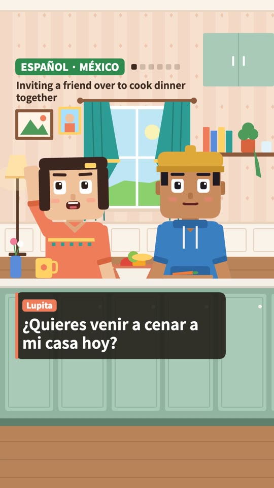
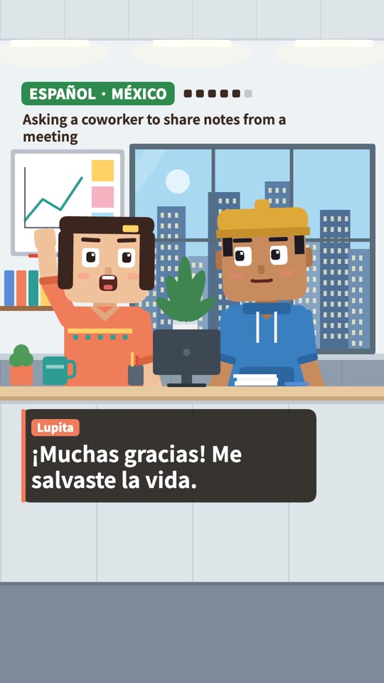
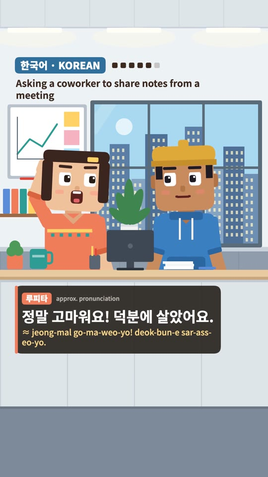
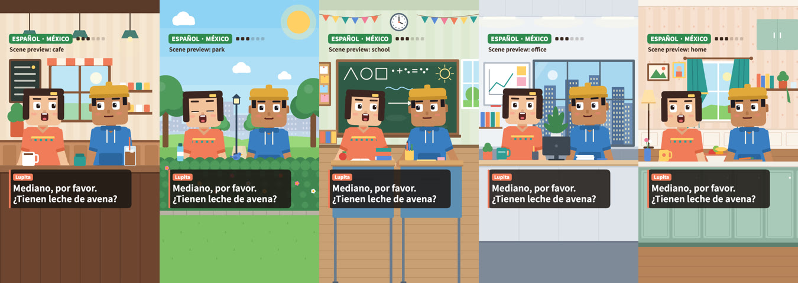

# learn-language: bilingual YouTube Shorts

Turns one topic (for example *"Ordering iced coffee at a café"*) into a vertical YouTube Short
(1080×1920, 30 fps, H.264 + AAC). The Short teaches the same dialogue in **Mexican Spanish**, then in **Korean**.

<p align="center">
  
</p>

<table align="center">
  <tr>
    <td align="center"><a href="https://youtube.com/shorts/dADMi7Ym1k8"></a></td>
    <td align="center"><a href="https://youtube.com/shorts/dADMi7Ym1k8"></a></td>
    <td align="center"><a href="https://youtube.com/shorts/gjFQUuWFemA"></a></td>
    <td align="center"><a href="https://youtube.com/shorts/gjFQUuWFemA"></a></td>
  </tr>
  <tr>
    <td align="center" colspan="2"><b>"Inviting a friend over to cook dinner"</b><br><a href="https://youtube.com/shorts/dADMi7Ym1k8">▶ Watch on YouTube (37 s)</a></td>
    <td align="center" colspan="2"><b>"Asking a coworker to share notes"</b><br><a href="https://youtube.com/shorts/gjFQUuWFemA">▶ Watch on YouTube (42 s)</a></td>
  </tr>
</table>

<p align="center"><sub>Both episodes were generated end to end from a single topic with real Gemini dialogue and speech.</sub></p>

## What it does

1. **Dialogue**: Gemini returns structured JSON with a top-level `sceneId` and 6 lines alternating between the
   recurring characters `lupita` and `jisoo`. Each line has `speaker`, `esMX`, `ko`, `koPronunciation` and
   `gesture`. The JSON is validated with zod.
2. **Speech**: one WAV per line (6 es-MX + 6 ko-KR), in a fixed voice per character and language. Choose the
   provider with `TTS_PROVIDER` (see [Speech providers](#speech-providers)):
   - **`edge`** (default, GitHub Actions too): Microsoft Edge TTS through the Python
     [`edge-tts`](https://github.com/rany2/edge-tts) CLI. No API key and no daily limit. One request per line,
     sequentially; each finished line is cached.
   - **`gemini`**: Gemini TTS, one request per character per language (4 per episode, to fit the free tier).
     Each clip is split at the pauses into one WAV per line.
3. **Timeline**: a shared timeline is built from the measured WAV durations. A short, bright opening jingle
   (an original marimba-style arpeggio synthesized in code, `src/audio/jingle.ts`) plays under the title card
   and fades out before the first line. Set `OPENING_MUSIC=off` to leave it out.
4. **Scene**: the two characters appear in one scene preset (see [Scenes](#scenes)). The scene is chosen once
   per episode and used for both language sections. The characters wave, nod, tilt and shrug, blink, shift
   their gaze, and move their mouths with the audio amplitude.
   - **Spanish section**: Spanish subtitles.
   - **Korean replay**: Hangul plus approximate pronunciation subtitles.
5. **Render**: Playwright headless Chromium renders the scene frame by frame at explicit timestamps.
   FFmpeg encodes the frames to MP4, and ffprobe verifies the output.

### Characters

Both characters are original blocky PixiJS designs. Their look and voices stay the same in every episode.

| Speaker ID | Who | Subtitle label (Spanish / Korean section) | Edge voices (es / ko) | Gemini voice |
| --- | --- | --- | --- | --- |
| `lupita` | Lupita, a woman from Mexico | Lupita / 루피타 | `es-MX-DaliaNeural` / `ko-KR-SunHiNeural` | Leda |
| `jisoo` | Jisoo, a man from Korea | Jisoo / 지수 | `es-MX-JorgeNeural` / `ko-KR-InJoonNeural` | Charon |

The names appear only as subtitle labels. They are spoken only when the dialogue itself uses them.

Gemini is told their genders so the Spanish matches the voices (for example `cansada` for Lupita, `cansado`
for Jisoo, `juntos` for both). If you override the voices with `EDGE_TTS_VOICE_*` or `GEMINI_TTS_VOICE_*`, keep
Lupita's voices female and Jisoo's male, or change the character descriptions in `src/dialogue/gemini.ts`.

### Scenes

The scene presets are defined in `shared/scenes.ts`.



| ID | Setting |
| --- | --- |
| `cafe` | Coffee shop counter and table |
| `park` | Outdoor park with trees and a bench |
| `school` | Classroom or school hallway |
| `office` | Office desk and meeting area |
| `home` | Living room or kitchen at home |

With `--scene auto` (the default), Gemini picks the scene that fits the topic. With an explicit scene, Gemini
writes the dialogue for that scene.

Output files (in `out/<slug>-<timestamp>/`, or the folder set with `--out`):

| File | Contents |
| --- | --- |
| `short.mp4` | The finished Short |
| `script.json` | Validated dialogue |
| `metadata.json` | YouTube title, description, tags, categoryId, privacyStatus (generated, with overrides applied) |

The description ends with hashtags: a fixed base set (`#Shorts #LearnKorean #LearnSpanish #Korean #Spanish
#Mexico #MexicanSpanish #KorMex`, edit `BASE_HASHTAGS` in `src/youtube/metadata.ts`) followed by 3–5
topic-specific hashtags that Gemini suggests in the same request as the dialogue (for example `#Tacos #Cooking`).
Suggested hashtags lose any `#`, spaces or hyphens, and duplicates are removed. The total is capped at 15,
because YouTube ignores every hashtag on a video that has more. They are also added to the video tags.
| `timeline.json` | Timing for every line and section |
| `audio/` | Per-line WAV files |

## Speech providers

| | `TTS_PROVIDER=edge` (default) | `TTS_PROVIDER=gemini` |
| --- | --- | --- |
| Service | Microsoft Edge read-aloud voices, via Python `edge-tts` (pinned in `requirements-tts.txt`) | Gemini TTS (`gemini-3.8-flash-lite-tts`) |
| Key | None | `GEMINI_API_KEY` |
| Daily limit | None published | 10 requests (about 2 videos) |
| Requests per video | 12 (one per line, sequential) | 4 (one per character per language) |
| Voice settings | `EDGE_TTS_VOICE_{LUPITA,JISOO}_{ES,KO}` | `GEMINI_TTS_VOICE_{LUPITA,JISOO}_{ES,KO}` |

Gemini always writes the dialogue; `TTS_PROVIDER` only picks who speaks it.

How the Edge provider works:

- **Voice check first.** Before anything else (including the Gemini dialogue request), the configured voices are
  checked against Edge's current voice list (`edge-tts --list-voices`) and their locale (`es-MX` / `ko-KR`).
  A missing voice stops the run and lists the voices that are available.
- **Per-line cache.** Each finished line is saved in `.cache/tts/edge/`, keyed by provider, voice and exact text
  (`TTS_CACHE_DIR` changes the folder). Re-running the same job reuses those lines. In GitHub Actions the cache
  is kept between attempts of the same run, so **Re-run failed jobs** reuses finished lines.
- **WAV and timing.** The provider's MP3 is converted to 24 kHz mono WAV with FFmpeg and trimmed to the speech.
  The measured WAV duration drives subtitles and animation.
- **Failure.** A failed line is retried once, then the run stops with the provider's error message. No video is
  rendered, and the upload job does not run.

Things to know about Edge TTS:

- It is an **unofficial** use of the service behind Edge's read-aloud feature. Microsoft gives no guarantee and
  has changed its access checks before, which breaks old `edge-tts` versions (they fail with HTTP 403). If that
  happens, raise the version in `requirements-tts.txt`, or switch to `TTS_PROVIDER=gemini`.
- Edge has only **two es-MX voices** (Dalia, Jorge) and **three ko-KR voices** (SunHi, InJoon,
  HyunsuMultilingual). Azure-only voices such as `es-MX-BeatrizNeural` and `ko-KR-JiMinNeural` are not available
  and fail the voice check.
- `edge-tts` is LGPL-3.0. It runs as a separate command and is not bundled into this project.

## Requirements

- **Node.js 22** (see `.nvmrc`; `nvm use` picks it up).
- **Python 3 with `edge-tts`** for the default speech provider: `pip install -r requirements-tts.txt` (a
  virtualenv works too; point `EDGE_TTS_BIN` at its `edge-tts`). Not needed with `TTS_PROVIDER=gemini` or for
  `npm run sample`.
- **ffmpeg and ffprobe** on `PATH`. On macOS: `brew install ffmpeg`. On Ubuntu: `sudo apt-get install ffmpeg`.
  If they live somewhere else, set `FFMPEG_PATH` / `FFPROBE_PATH`.
- **Playwright Chromium**: install with `npx playwright install chromium`. No GPU is needed. Video frames are drawn
  with PixiJS's Canvas renderer by default (pure CPU, about 2× faster than WebGL on SwiftShader, same image).
  Use `--renderer webgl` to render through WebGL on SwiftShader instead. The browser preview picks WebGL when
  it is available.

## Quick start (no credentials)

`npm run sample` uses a fixed bilingual dialogue and locally synthesized test audio. The audio is beeps and
babble, not real speech. No API key is needed.

```bash
npm ci
npx playwright install chromium
npm run sample                              # → out/sample/short.mp4
npm run verify:video -- out/sample/short.mp4  # ffprobe: 1080×1920, 30 fps, H.264, AAC, duration
npm run frames -- out/sample                # sample PNG frames → out/sample/frames/
npm run preview -- out/sample               # browser preview with audio at http://127.0.0.1:5173
```

Two more commands that need no credentials:

```bash
npm run sample:park       # the fixed sample dialogue in the park scene
npm run scenes:preview    # one preview PNG per scene preset → out/scene-previews/
```

`npm run sample` always uses the café scene.

The preview uses the same PixiJS scene as video rendering. To re-render an existing job's video from its
timeline and audio, run `npm run render -- out/sample`.

## Local live generation

```bash
cp .env.example .env        # then set GEMINI_API_KEY (TTS_PROVIDER defaults to edge)
pip install -r requirements-tts.txt   # Edge TTS (skip for TTS_PROVIDER=gemini)
npm run tts:smoke           # one Spanish + one Korean WAV in out/tts-smoke/, to check before a full render
npm run generate -- --topic "Ordering iced coffee at a café"
```

`tts:smoke` uses `TTS_PROVIDER`, accepts `--out`, `--es "..."` and `--ko "..."`, and never reads the TTS cache.
With Edge it also verifies the voice ids.

Options for `generate`:

| Option | Meaning |
| --- | --- |
| `--topic "..."` | Required. The conversation topic. |
| `--scene auto\|cafe\|park\|school\|office\|home` | Scene preset. Default `auto` (Gemini picks it). |
| `--out out/my-job` | Output folder. Default: `out/<slug>-<timestamp>`. |
| `--privacy private\|unlisted\|public` | `privacyStatus` written to `metadata.json` |
| `--title "..."` / `--description "..."` | Override the generated metadata. An empty string means no override. |
| `--resume` | With `--out` of a run that stopped partway: reuse its `script.json` (no new dialogue request) and, with Gemini TTS, its finished WAVs. Edge lines come from the line cache either way. |
| `--renderer canvas\|webgl`, `--concurrency N` | Rendering backend (default `canvas`) and number of parallel browser pages. |

Other commands: `npm test` and `npm run typecheck`.

## Gemini API key

1. Create a key at <https://aistudio.google.com/apikey>. The free tier is enough.
2. Put it in `.env` as `GEMINI_API_KEY` (locally) and in the `GEMINI_API_KEY` repository secret (for CI).
   The same key is used for dialogue and for TTS.

Models and voices (all optional):

| Variable | Default | Used for |
| --- | --- | --- |
| `GEMINI_MODEL` | `gemini-3.6-flash` | Structured JSON dialogue |
| `GEMINI_TTS_MODEL` | `gemini-3.8-flash-lite-tts` | Speech |
| `GEMINI_TTS_VOICE_LUPITA_ES` / `GEMINI_TTS_VOICE_LUPITA_KO` | `Leda` | Lupita's Spanish / Korean voice |
| `GEMINI_TTS_VOICE_JISOO_ES` / `GEMINI_TTS_VOICE_JISOO_KO` | `Charon` | Jisoo's Spanish / Korean voice |
| `GEMINI_TTS_RPM` | `3` | Requests per minute for pacing TTS calls (raise it only if your limit is higher) |

Check your current limits at <https://aistudio.google.com/rate-limit>.

**Free-tier TTS limits matter most.** In November 2026, the API reported these limits for
`gemini-3.8-flash-lite-tts` on the free tier: **3 requests per minute** and **10 requests per day**. The
pipeline works within them:

- Each episode makes **4 TTS requests**: Lupita es, Jisoo es, Lupita ko, Jisoo ko. That allows about
  **2 full episodes per day**. `npm run tts:smoke` uses 2 requests.
- Requests are paced 60 s / `GEMINI_TTS_RPM` apart. The default of 3 gives about 20 s, so TTS takes about 1 minute.
- A per-minute 429 with a short server-suggested delay is waited out (at most 3 times). A per-day quota error
  stops immediately with exit code 3. Re-run later with `--resume --out <same folder>`.
- Dialogue generation is a single request per episode, plus at most one retry if validation fails.

> **Note:** on the free tier, Google may use your prompts and responses to improve its products. Do not put
> anything confidential in topics or overrides.

## GitHub Actions

The workflow `.github/workflows/short.yml` ("Generate bilingual Short") is started by hand only (`workflow_dispatch`).

### Secrets and variables

Set these under **Settings → Secrets and variables → Actions**.

| Name | Kind | Required | Purpose |
| --- | --- | --- | --- |
| `GEMINI_API_KEY` | Secret | Yes | Dialogue (and speech when the `tts_provider` input is `gemini`) |
| `YOUTUBE_CLIENT_ID` | Secret | Only for upload | Desktop OAuth client ID |
| `YOUTUBE_CLIENT_SECRET` | Secret | Only for upload | Desktop OAuth client secret |
| `YOUTUBE_REFRESH_TOKEN` | Secret | Only for upload | From `npm run youtube:authorize` |
| `GEMINI_MODEL` | Variable | No | Dialogue model override |
| `GEMINI_TTS_MODEL` | Variable | No | TTS model override |
| `GEMINI_TTS_RPM` | Variable | No | TTS requests per minute for pacing (default 3) |
| `GEMINI_TTS_VOICE_LUPITA_ES`, `GEMINI_TTS_VOICE_LUPITA_KO`, `GEMINI_TTS_VOICE_JISOO_ES`, `GEMINI_TTS_VOICE_JISOO_KO` | Variable | No | Gemini voice overrides |
| `EDGE_TTS_VOICE_LUPITA_ES`, `EDGE_TTS_VOICE_LUPITA_KO`, `EDGE_TTS_VOICE_JISOO_ES`, `EDGE_TTS_VOICE_JISOO_KO` | Variable | No | Edge voice overrides (checked against Edge's voice list) |

The YouTube secrets can be repository secrets or secrets of the `youtube` environment. Environment secrets
are only available to the approved upload job.

```bash
gh secret set GEMINI_API_KEY            # paste the key when prompted (it stays out of shell history)
gh variable set GEMINI_MODEL --body "gemini-3.6-flash"            # optional
gh variable set GEMINI_TTS_MODEL --body "gemini-3.8-flash-lite-tts"  # optional
```

### The `youtube` environment

1. Go to **Settings → Environments → New environment** and create one named `youtube`.
2. Turn on **Required reviewers** and add yourself.

The `upload` job waits for your approval. Before approving, open the run summary and check the generated
**title, description and visibility**.

The MP4 artifact is stored before the upload job starts. If the upload fails, the video is not lost.

### Running it

1. Go to **Actions → Generate bilingual Short → Run workflow**.
2. Fill in:
   - `topic` (required)
   - `scene` (`auto` / `cafe` / `park` / `school` / `office` / `home`, default `auto`)
   - `tts_provider` (`edge` / `gemini`, default `edge`)
   - `upload` (default off)
   - `visibility` (`private` / `unlisted` / `public`, default `private`)
   - optional `title_override` / `description_override`
3. When the run finishes, download the artifact `short-<run id>` from the run page. It contains `short.mp4`,
   `script.json`, `metadata.json` and `timeline.json`, and is kept for 14 days. You can also download it from
   the command line:

   ```bash
   gh run list --workflow short.yml
   gh run download <run-id> --dir out/ci
   ```

If generation fails, a `debug-script-<run id>` artifact holds `script.json` when the dialogue step got that far.

The generate job runs on a standard `ubuntu-24.04` runner with no GPU. It installs ffmpeg and Playwright
Chromium (`--with-deps --only-shell`) itself. With `tts_provider: edge` it also sets up Python, installs
`requirements-tts.txt`, and runs an **Edge TTS smoke test** (voice check plus one Spanish and one Korean line)
before generating, so a broken provider fails fast and costs no Gemini request.

## First-time YouTube authorization

1. In the [Google Cloud Console](https://console.cloud.google.com/), create a project (or pick one).
2. Under **APIs & Services → Library**, enable **YouTube Data API v3**.
3. Set up the **OAuth consent screen**:
   - User type: **External**.
   - Either add your Google account under **Test users**, or **publish the app to production**.
   - While the app is in **Testing** mode, refresh tokens expire after **7 days**. You would then have to rerun
     the authorize step and update the secret every week. Publishing to production avoids this. For a personal
     app using only `youtube.upload`, Google shows an "unverified app" warning that you can click through.
4. Under **Credentials → Create credentials → OAuth client ID**, choose application type **Desktop app**.
5. Download the JSON and save it as `client_secret.json` in the repo root. It is gitignored.
6. Run:

   ```bash
   npm run youtube:authorize -- ./client_secret.json
   ```

   This opens your browser. The redirect goes to a `127.0.0.1` loopback address and uses state + PKCE, with
   offline access and scope `https://www.googleapis.com/auth/youtube.upload`. The refresh token is saved to
   `.secrets/youtube-token.json` (mode 0600). The token itself is never printed.
7. The command prints `gh secret set` commands that read the values from files. Run them to set
   `YOUTUBE_CLIENT_ID`, `YOUTUBE_CLIENT_SECRET` and `YOUTUBE_REFRESH_TOKEN`.

## Private test upload

Start with a private upload. Either:

- **In CI:** run the workflow with `upload` = true and `visibility` = `private`, then approve the `youtube`
  environment.
- **Locally:** check everything with a dry run first, then upload for real:

  ```bash
  npm run youtube:upload -- --video out/my-job/short.mp4 --metadata out/my-job/metadata.json --privacy private --dry-run
  npm run youtube:upload -- --video out/my-job/short.mp4 --metadata out/my-job/metadata.json --privacy private
  ```

How the upload command behaves:

- `--privacy` is required and must match `privacyStatus` in `metadata.json`. If they differ, the command refuses
  to upload. Generate with the same `--privacy`, or edit `metadata.json`.
- `--title` / `--description` override the metadata. `--dry-run` checks everything without uploading.
- The upload uses YouTube Data API v3 `videos.insert` (resumable).
- In CI, `video_id` and `video_url` are written to the job outputs.

> **Unverified API projects:** YouTube locks videos uploaded through an unaudited API project to **private**,
> until the project passes YouTube's API compliance audit. If you request `unlisted` or `public` and YouTube
> reports a different privacy, the upload command **fails loudly** instead of reporting success.

## How many videos per day?

It depends on the speech provider:

- **`TTS_PROVIDER=edge` (default):** no published daily limit for speech. In practice the limits are the Gemini
  dialogue quota and YouTube uploads (**about 6 uploads per day**). Generating without uploading is not capped by
  either. Be reasonable with volume: the Edge service is unofficial and may throttle heavy use.
- **`TTS_PROVIDER=gemini`:** about **2 videos per day**. Gemini text-to-speech is the limit.

| Limit | Daily cap | Per video | Videos per day |
| --- | --- | --- | --- |
| Edge TTS | none published | 12 requests (cached lines are free) | not the bottleneck |
| **Gemini TTS** (`gemini-3.8-flash-lite-tts`), only with `TTS_PROVIDER=gemini` | 10 requests (and 3 per minute) | 4 requests | **2** |
| Gemini dialogue (`gemini-3.6-flash`) | much higher | 1–2 requests | not the bottleneck |
| YouTube upload API | 10,000 units by default | ~1,600 units per upload | about 6 |
| GitHub Actions | free on public repos; 2,000 min/month on private | ~5–7 min | not the bottleneck |

With Gemini TTS:

- **Reset time:** the Gemini daily quota resets at midnight Pacific time (3 AM EST).
- **Spare requests:** two videos use 8 of the 10 TTS requests, which leaves 2 for recovery. If a local run stops
  partway, re-run it with `--resume` and the same `--out` folder to reuse the audio already made.
- **Re-rendering is free:** `npm run render` and `npm run sample` make no Gemini requests.
- **More than 2 a day:** use `TTS_PROVIDER=edge`, point `GEMINI_TTS_MODEL` at another TTS model (each model has
  its own free quota), or enable billing on the Gemini project. Billing is no longer free, so the pipeline never does it on its own.

Free-tier limits are set by Google and can change. Check your current limits at
[aistudio.google.com/rate-limit](https://aistudio.google.com/rate-limit).

## Quotas and failure behavior

| Exit code | Meaning |
| --- | --- |
| `3` | A free-tier quota (Gemini or YouTube) is exhausted. The message says which one. Wait for the quota to reset. |
| `2` | User-facing error: bad input, missing key, failed validation, privacy mismatch, and so on. |
| `1` | Unexpected error (bug). |

There is **no paid fallback**. The pipeline never switches to a billed model or service when the free tier runs out.

YouTube Data API uploads also use the Google Cloud project's daily YouTube quota (10,000 units by default).
Each `videos.insert` call costs a large share of it; see Google's
[quota cost table](https://developers.google.com/youtube/v3/determine_quota_cost) for the current figure.

## Security notes

- Secrets live only in `.env` (gitignored), `.secrets/` (gitignored, token file mode 0600) and GitHub secrets.
  They are never in Git, workflow artifacts, the web/browser bundle or logs.
- Artifacts include only `short.mp4`, `script.json`, `metadata.json` and `timeline.json`.
- Workflow inputs (topic, scene, overrides, visibility) are passed to scripts through `env:` and quoted shell
  variables. They are never interpolated into `run:` scripts, which prevents script injection. The summary step
  reads `metadata.json` from disk.
- The workflow has `permissions: contents: read`, and checkout does not keep credentials.
- Uploads need approval on the `youtube` environment. Visibility comes only from the selected input.
- `client_secret*.json`, `*token*.json`, `.env*` (except `.env.example`), `.secrets/` and `out/` are gitignored.

## Troubleshooting

- **ffmpeg fails with missing libraries on macOS** (`dyld: Library not loaded`): run `brew reinstall ffmpeg`.
- **WebGL problems in headless Chromium:** video rendering uses the PixiJS Canvas renderer by default, which
  needs no GPU or WebGL. With `--renderer webgl`, Chromium is launched with SwiftShader flags.
- **Korean text shows boxes:** fonts are bundled through `@fontsource/noto-sans-kr`, so system CJK fonts are not
  needed (Ubuntu runners included). Run `npm ci` again if `node_modules` is incomplete.
- **Playwright cannot find a browser:** run `npx playwright install chromium`. On Linux, use
  `npx playwright install --with-deps chromium`.
- **Edge TTS fails with HTTP 403 or `WSServerHandshakeError`:** Microsoft changed the service's access check.
  Raise the `edge-tts` version in `requirements-tts.txt` (check [PyPI](https://pypi.org/project/edge-tts/)), or
  run with `TTS_PROVIDER=gemini` meanwhile.
- **`edge-tts command not found`:** run `pip install -r requirements-tts.txt`, or set `EDGE_TTS_BIN` to the
  `edge-tts` inside your virtualenv.
- **Exit code 3:** see [Quotas and failure behavior](#quotas-and-failure-behavior).
- **Refresh token stopped working after a week:** the OAuth consent screen is still in Testing mode. See
  [First-time YouTube authorization](#first-time-youtube-authorization).

## Project layout

```text
src/cli/        Command entry points (generate, render, preview, verify, frames, tts:smoke, scenes:preview, youtube:*)
src/dialogue/   Dialogue prompt, schema and validation
src/gemini/     Gemini API client (structured output, quota/error handling)
src/tts/        Edge TTS (per line, cached) or Gemini TTS (4 batched requests) → per-line WAVs; local test voice for sample mode
src/audio/      WAV parsing/writing, pause-based line splitting
src/timeline/   Shared timeline from measured audio durations
src/render/     Playwright frame capture, FFmpeg encoding, ffprobe verification
src/youtube/    OAuth (loopback + PKCE) and resumable upload
shared/         Types, scene registry (scenes.ts) and animation helpers shared by Node and the browser
web/scene/      PixiJS scene backgrounds, characters and subtitle overlay
test/           Unit tests (npm test)
.github/workflows/short.yml   Manual CI workflow
```

## Verification status

Checked on 2026-11-22 (macOS, Node 22, Playwright Chromium headless shell, FFmpeg 6.1):

- `npm test`: 53 tests pass (schema, Gemini client with mocked HTTP, batched TTS + pause splitting, Edge voice
  check / line cache / failure handling with a mocked CLI, timeline,
  scene registry, YouTube metadata/OAuth/upload with mocked HTTP and a local loopback server). `npm run typecheck` is clean.
- `npm run sample` (café) and `npm run sample:park`: full 41 s / 40 s renders. ffprobe confirmed 1080×1920,
  30 fps, H.264 yuv420p, AAC 48 kHz, and duration and frame count matching the timeline. Frames from both
  language sections showed both characters and legible Spanish and Hangul + pronunciation subtitles. In the
  park video, the scene, framing and character positions are the same in both sections.
- `npm run scenes:preview`: one frame per preset (cafe, park, school, office, home) inspected for character
  placement and subtitle readability.
- Live Gemini, run with a real free-tier key:
  - `tts:smoke`.
  - A full `--scene home` episode: 1 dialogue request + 4 TTS requests → per-line WAVs → render → ffprobe OK.
  - A `--scene auto` episode (Gemini chose `office`), finished with `--resume` after hitting the daily TTS limit.
  - The free-tier limits seen from the API: 3 TTS requests/min, 10/day.
- Edge TTS with `edge-tts` 7.3.1: the voice check found all four default voices; `tts:smoke` produced a Spanish
  (Dalia, 3.6 s) and a Korean (InJoon, 3.8 s) WAV; a full home episode (the saved script, 12 Edge lines in about
  14 s) rendered and passed every ffprobe check.
- The browser bundle and all outputs were searched for the API key (none found). The preview server returns
  404 for `.env`, `script.json` and path traversal attempts.
- `youtube:upload --dry-run` printed the request; a visibility mismatch was refused before any network call.

GitHub Actions: Gemini-TTS runs have succeeded on `ubuntu-24.04`. The Edge steps (Python setup, smoke test,
line cache) have not run on GitHub yet. Also not verified: OAuth authorization
and a real YouTube upload, which need your Google OAuth client. Nothing was uploaded to YouTube.
